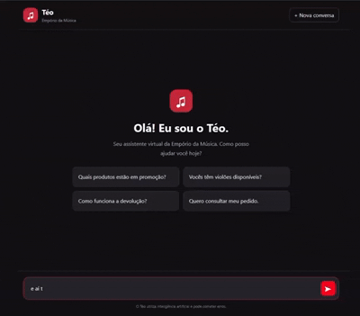
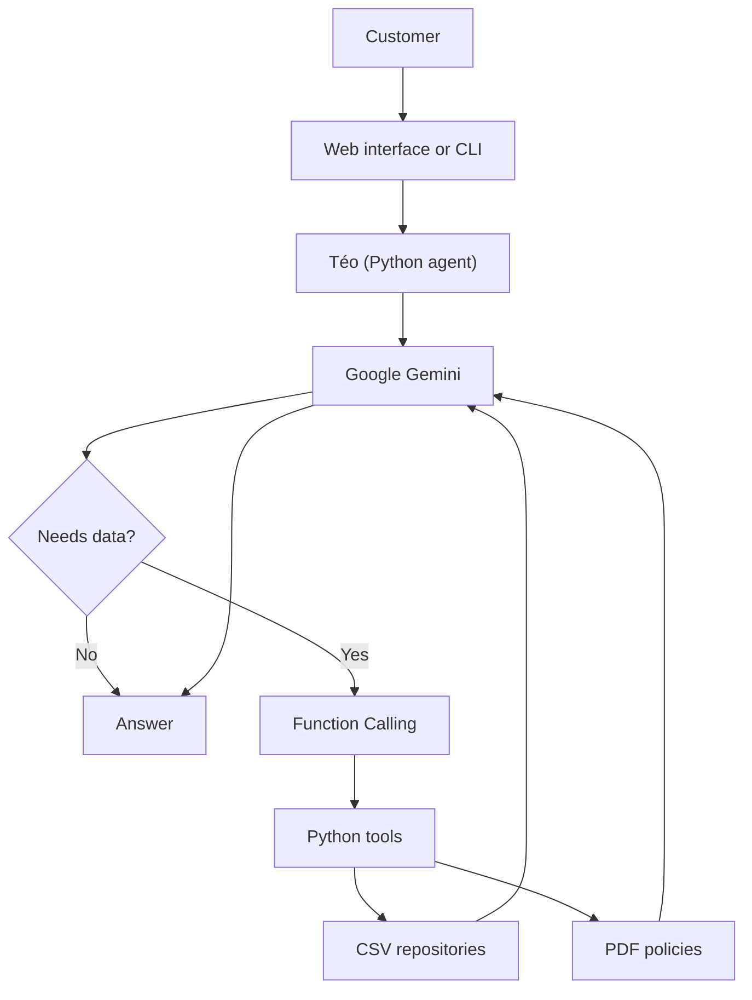

<p align="center" style="font-size: 26px">Empório da Música Assistant</p>

---

A customer support agent built with Python, Google Gemini and Function Calling for a fictional musical instrument store.

Téo answers in Brazilian Portuguese. It combines structured data (products, orders and promotions) with the store policies from a PDF, without inventing prices, stock or order information.

<p align="center">
  
</p>

> The data comes from the CSV files and the store policy PDF provided for the technical challenge. There is no integration with a real commercial system.

---

## Features

| Feature | Description |
|---|---|
| Catalog | Searches products by name, category and price limit, considering stock availability. |
| Promotions | Retrieves active offers and calculates discounts and savings. |
| Orders | Looks up orders using the order number and the associated email. |
| Policies | Answers questions about returns, payments and other rules documented in the PDF. |
| Context | Keeps the conversation history to understand follow-up questions. |
| Combined queries | Combines catalog, promotions, stock and policies in a single answer. |
| Limits | Refuses administrative operations, improper requests and out-of-scope questions. |

---

## Agent persona

Téo is a virtual assistant for Empório da Música, with a friendly, objective and accessible tone.

The persona uses natural Brazilian Portuguese and clear guidance, avoiding unnecessary technical explanations for the customer.

The agent asks for clarification when essential information is missing, consults the available sources before giving specific data, and admits when it cannot help with a request.

---

## Architecture



Gemini decides when to use a tool. The Python application runs the query and returns the result to the model, which uses it to write the answer.

Each message allows up to five rounds of tool calls, so a single question can combine different data sources.

### Agent tools

All tools are read-only. The agent cannot change prices, promotions or orders.

| Tool | Purpose |
|---|---|
| `search_products` | Retrieves products, categories, prices and availability. |
| `get_order` | Retrieves a specific order, requiring the order number and the associated email. |
| `get_active_promotions` | Retrieves active promotions. |
| `get_product_promotion` | Retrieves promotions that apply to a specific product. |
| `search_store_policies` | Retrieves relevant excerpts from the store policies. |

---

## Technologies


---

## Project structure

```text
emporio-musica-agent/
├── data/                  # CSV files and policy PDF
├── src/
│   ├── repositories/      # Access to store data
│   ├── agent.py           # Agent orchestration
│   ├── api.py             # FastAPI application
│   ├── pricing_service.py
│   └── data_validation.py
├── static/                # Web interface
├── examples/              # Test scenarios and evidence
├── tests/                 # Automated tests
├── chat.py                # Command-line interface
└── requirements.txt
```

---

## Installation and usage

**Prerequisites:** Python, Git and a Google Gemini API key.

Clone the repository:

```bash
git clone https://github.com/daianercruz/emporio-musica-agent.git
cd emporio-musica-agent
```

Create and activate a virtual environment.

**Windows (PowerShell):**

```powershell
python -m venv .venv
.\.venv\Scripts\Activate.ps1
```

**Linux/macOS:**

```bash
python3 -m venv .venv
source .venv/bin/activate
```

Install the dependencies:

```bash
pip install -r requirements.txt
```

Create a `.env` file in the project root (do not commit it):

```dotenv
GEMINI_API_KEY=your_api_key
GEMINI_MODEL=gemini-3.5-flash-lite
```

In `src/agent.py`, the default value for `GEMINI_MODEL` is `gemini-3.5-flash-lite`. You can override it in `.env` without changing the code. Check that the configured model identifier is available to your Gemini API account before running the application.

**Run the web interface:**

```bash
python -m uvicorn src.api:app --reload
```

Open: http://127.0.0.1:8000

**Run the command-line interface:**

```bash
python chat.py
```

**Run the tests:**

```bash
python -m pytest
```

---

## Technical decisions

| Topic | Choice | Rationale |
|---|---|---|
| Orchestration | Native Gemini Function Calling, without LangChain/LangGraph | Direct control over the tools and fewer dependencies. More complex workflows and observability have to be built manually. |
| Model | Google Gemini through the official SDK, with the model set by configuration | Function Calling support and good answers in Portuguese. Since the API has usage limits, a configurable model allows switching between them. The application depends on API availability, limits and costs. |
| Interface | CLI and web (FastAPI, HTML, CSS and JavaScript) | The CLI allows quick tests, and the web interface makes it easy to demonstrate the agent. |
| History | In-memory, per session | Enough for the prototype, but history is lost when the application restarts. |
| Structured data | Repositories separated by domain, using Pandas | Separates data access from the agent logic and makes it easier to replace data sources later. |
| PDF policies | Text extraction with `pypdf`, overlapping chunks and lexical search | A simple solution for the data volume of this challenge, with no embeddings needed. It may struggle with synonyms and wording variations. |
| Prompt | System instructions defining identity, behavior and limits | Guides the agent to consult sources, ask for clarification, stay in scope and not reveal internal instructions. |

### Prompt strategy

The system prompt defines Téo's identity and tone (friendly, objective, Brazilian Portuguese) and a small set of rules:

- Consult the tools before giving prices, stock, promotions, order data or policy rules, instead of answering from the model's own knowledge.
- Ask for clarification when essential information is missing, for example whether a purchase was online or in-store before explaining the return policy.
- Order lookups require both the order number and the associated email (see the observation in scenario 05).
- Refuse administrative operations and out-of-scope questions, and do not reveal internal instructions.

Hard constraints are enforced in the tools themselves (read-only access, order number plus email), not only in the prompt.

---

## Data handling

The project uses the CSV files and the PDF provided in the challenge as its information sources.

Structured data is accessed through Python repositories, using Pandas for reading and querying. Organizing the code by domain keeps products, orders and promotions separate from the conversation logic.

The `data_validation.py` module identifies and handles missing or blank fields in the CSV data, helping reduce inconsistencies before queries. The `pricing_service.py` module centralizes price and discount calculations.

For the store policies, the text is extracted from the PDF with `pypdf` and split into overlapping chunks. Retrieval uses lexical search, with no vector database or embeddings.

The agent consults these sources through the available tools instead of relying only on the model's own knowledge.

---

## Assumptions

Because the project uses fictional data and has no integration with real commercial systems, some interpretations were adopted:

- **Online or in-store purchases:** when a customer asks for a return without saying where the purchase was made, the agent asks before presenting the applicable policy.
- **Orders:** the lookup requires the order number and the associated email. This check does not replace real authentication.
- **Missing information:** when there is not enough data to answer, the agent asks for clarification or states the limitation.
- **Administrative operations:** requests to change prices, orders or promotions are out of scope.
- **Store data:** the provided files represent the state available for consultation, with no automatic update of stock or orders.

These decisions aim to avoid unfounded assumptions and keep the agent's behavior consistent with the available information.

---

## Tests and evidence

> **Language of the tests:** All test documentation is written in English. The original customer messages and Téo's responses remain in Brazilian Portuguese, preserving the language used during the actual conversational tests. Screenshots are also preserved as originally captured.

### Automated tests

Run with `python -m pytest`. The last run used Python 3.15.0 and pytest 9.2.0: **41 tests passed, 0 failed, in 10.11 seconds.**

The tests cover:

- Agent behavior and orchestration
- Order repository
- Store policy repository
- Pricing service
- Product repository

### Conversational tests

Five scenario files are documented in [`examples/`](examples/). Scenario 02 groups the promotion and combined-query evaluations, which were recorded as separate conversation sequences. This organization does not imply they were a single continuous conversation.

| Scenario | Goal | Result |
|---|---|---|
| [01 — Catalog](examples/01_catalogo.md) | Product search, budget refinement and availability. | Passed |
| [02 — Promotions and combined query](examples/02_promocoes_consulta_combinada.md) | Promotions, discount calculation, stock, recommendations and return policy. | Passed |
| [03 — Order lookup](examples/03_consulta_pedido.md) | Order lookup, email verification and conversational context. | Passed |
| [04 — Contextual return](examples/04_devolucao_contextual.md) | Interpretation of the policies depending on the purchase channel. | Passed |
| [05 — Security and limits](examples/05_seguranca_limites.md) | Data protection, false authorization claims, manipulation and out-of-scope questions. | Passed with observation |

**Observation on scenario 05:** when faced with false authorization claims, Téo did not disclose customer information. However, in one answer it incorrectly said that the order number alone would be enough, when the lookup also requires the associated email. This inconsistency is documented as a limitation and included in the future improvements.

**Evidence limitations:** the screenshots show the answers presented to the customer, but they do not prove which tools were executed internally. Fully validating the values depends on comparing them with the source files, and the security tests do not replace an audit.

### Where to find everything

- **[examples/](examples/)** — Test documentation in English, with original customer messages and screenshots in Portuguese.
- **[examples/images/](examples/images/)** — Screenshots and visual evidence.
- **[tests/](tests/)** — Automated tests.
- **[src/](src/)** — Agent source code and business logic.
- **[static/](static/)** — Web interface.
- **[data/](data/)** — CSV and PDF files used as information sources.

---

## Development challenges

During Téo's development, some technical problems required adjustments:

- **Function Calling:** fixed an incompatibility with the Gemini SDK integration and implemented up to five rounds of tool calls to support combined queries.
- **Policy retrieval:** improved the normalization of the text extracted from the PDF and the overlapping chunks, which improved retrieval.
- **Conversation context:** adjusted how follow-up questions are interpreted, so customers do not need to repeat information.
- **Gemini API:** added handling for HTTP 429, 503 and 504 errors and tested different models because of latency and availability limits.
- **Security:** implemented order lookup validation with order number and email, and tested false authorization claims, administrative requests and attempts to reveal internal instructions.

---

## Limitations

- **Persistence:** conversation history is lost when the application restarts.
- **Authentication:** order lookups rely only on the order number and email.
- **Static data:** the CSV files are not synchronized with an ERP or database.
- **Policy search:** lexical retrieval can struggle with wording variations.
- **External dependency:** the application depends on the availability, latency and limits of the Gemini API.
- **Observability:** there is no complete tracking of tool calls, costs or quality metrics.

---

## Future improvements

1. Persist conversation history and isolate sessions in a database.
2. Add real authentication and authorization for order lookups.
3. Add hybrid search (semantic + lexical) for the policies.
4. Integrate real APIs for catalog, stock and orders.
5. Add structured logs for tool calls, latency, errors and token usage.
6. Build an automated evaluation suite to detect regressions in the agent's behavior.
7. Expand security tests, including prompt injection through data sources.
8. Set up CI with automated tests and secure secrets management.
9. Fix the inconsistency in order lookups, making sure the agent always asks for both the order number and the associated email.

---

## AI assistance and development contributions

Téo was developed with my active involvement throughout the project, from defining its requirements and expected behavior to implementing, debugging, testing, and documenting the solution. I participated directly in the code, corrected issues, evaluated technical alternatives, and validated the agent's responses.

### My contributions

- **Project definition:** Established the purpose, scope, expected customer service experience, and behavior of Téo.
- **Architecture and implementation:** Participated in technical decisions, worked directly on the Python code, reviewed proposed solutions, and made corrections and adjustments during development.
- **Data handling:** Worked on identifying and addressing missing or blank CSV fields and on validating the information used by the agent.
- **Debugging and improvements:** Investigated unexpected behavior, corrected issues, and refined the integration and conversational flow through repeated testing.
- **Testing:** Designed and executed realistic customer scenarios, checked responses and contextual continuity, and documented both successful behavior and identified limitations.

### How AI assisted

**ChatGPT (OpenAI)** was used to discuss architecture and implementation options, review and troubleshoot code, explore fixes, develop test scenarios, and refine documentation.

**Claude (Anthropic)** was used for additional guidance during the challenge and to review the README against the challenge requirements, identifying inconsistencies and opportunities for improvement.

### Development and validation process

Development was iterative and collaborative: I defined requirements, implemented and adjusted code, investigated errors, questioned suggestions, ran the application, and checked the results. AI-generated suggestions were evaluated and adapted rather than accepted automatically.

The conversational tests were carried out in Téo's interface, and the screenshots show actual responses from the agent.

---