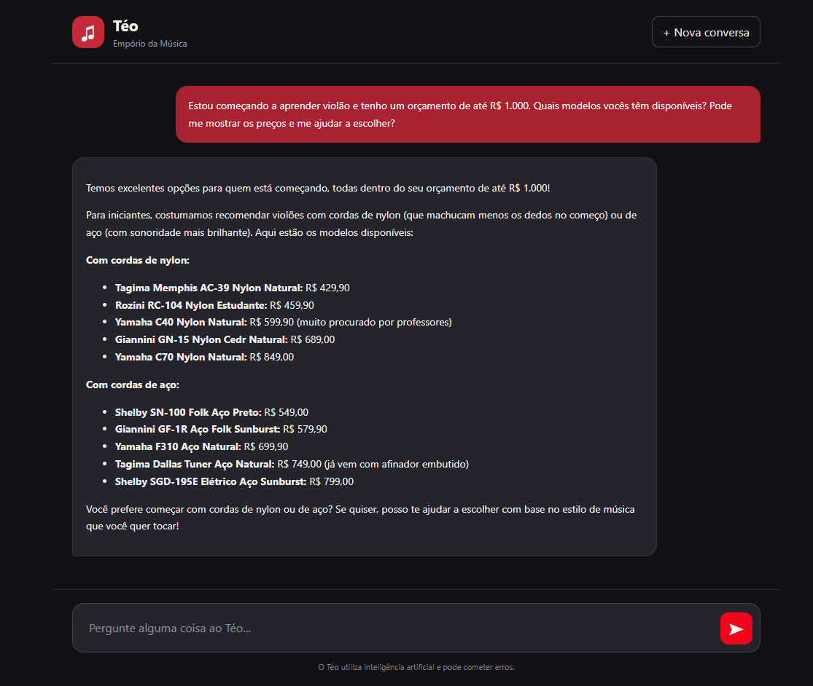
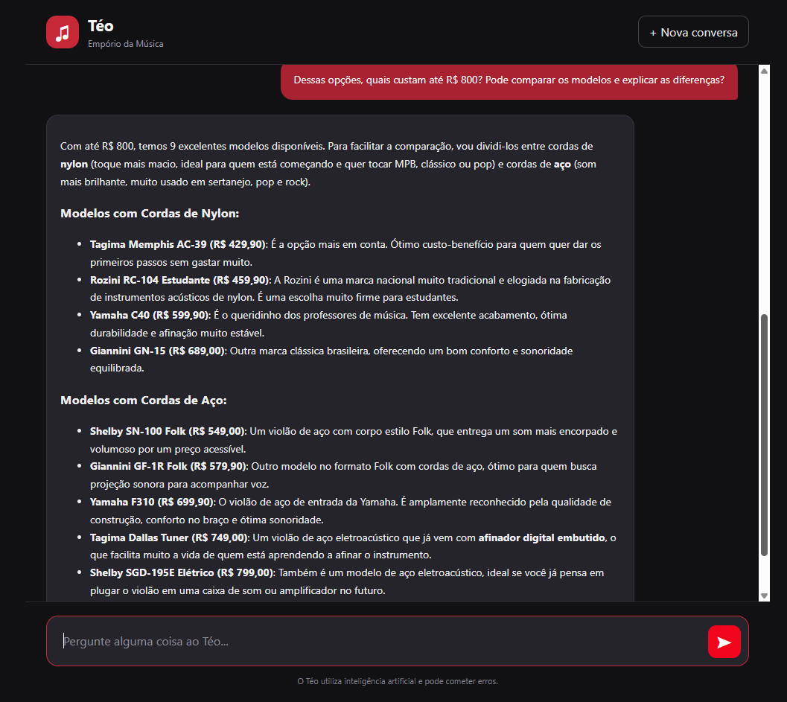
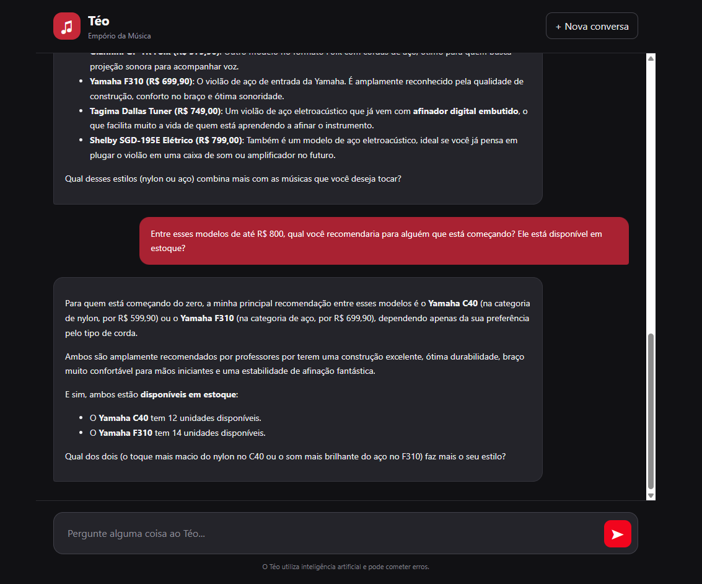

# Teste — Consulta ao catálogo

**Objetivo:** Busca de produtos, limite de preço, disponibilidade e recomendações.

**Ferramentas esperadas:** `search_products`

## Transcrição real

### Mensagem 1

**Cliente:**

> Estou começando a aprender violão e tenho um orçamento de até R$ 1.000. Quais modelos vocês têm disponíveis? Pode me mostrar os preços e me ajudar a escolher?

**Téo (resposta real):**

> 

### Mensagem 2

**Cliente:**

> Dessas opções, quais custam até R$ 800? Pode comparar os modelos e explicar as diferenças?

**Téo (resposta real):**

> 

### Mensagem 3

**Cliente:**

> Entre esses modelos de até R$ 800, qual você recomendaria para alguém que está começando? Ele está disponível em estoque?

**Téo (resposta real):**

> 

## Avaliação

- **Resultado:** Aprovado.
- **Comportamento observado:**
  - Apresentou 10 modelos de violões dentro do orçamento inicial de R$ 1.000.
  - Refinou a consulta para 9 modelos de até R$ 800.
  - Comparou instrumentos com cordas de nylon e aço.
  - Manteve o contexto entre as três perguntas.
  - Recomendou o Yamaha C40 e o Yamaha F310 para iniciantes.
  - Informou a disponibilidade de 12 unidades do Yamaha C40 e 14 unidades do Yamaha F310.

- **Observações:**
  - As respostas foram organizadas e apresentadas em linguagem acessível.
  - O agente demonstrou capacidade de refinar resultados e oferecer recomendações contextualizadas.
  - Não foram identificadas falhas aparentes durante a interação.