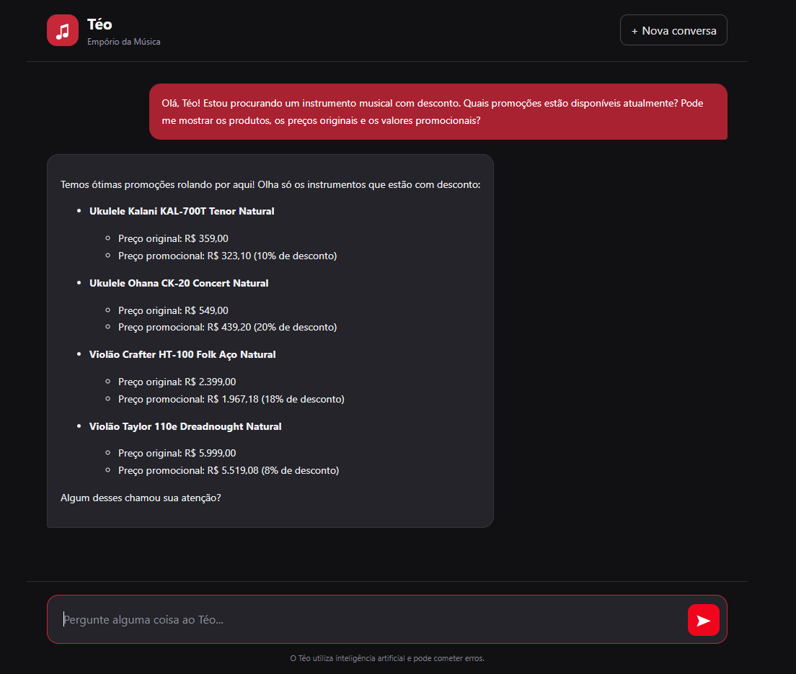
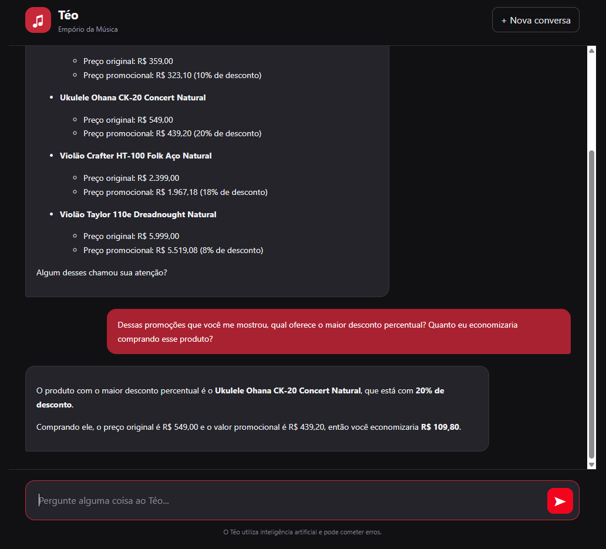
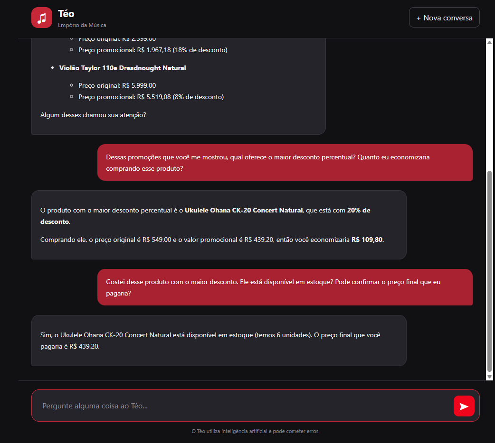

# Teste 02 — Promoções e cálculo de descontos

**Objetivo:** Validar a consulta de promoções ativas, a apresentação de preços e descontos e a manutenção do contexto durante o atendimento.

**Ferramentas esperadas:** `get_active_promotions`, `get_product_promotion` e, se necessário, `search_products`.

## Transcrição real

### Mensagem 1 — Consulta de promoções

**Cliente:**

> Olá, Téo! Estou procurando um instrumento musical com desconto. Quais promoções estão disponíveis atualmente? Pode me mostrar os produtos, os preços originais e os valores promocionais?

**Téo (resposta real):**

### Mensagem 2 — Comparação de descontos

**Cliente:**

> Dessas promoções que você me mostrou, qual oferece o maior desconto percentual? Quanto eu economizaria comprando esse produto?

**Téo (resposta real):**

### Mensagem 3 — Verificação de produto e estoque

**Cliente:**

> Gostei desse produto com o maior desconto. Ele está disponível em estoque? Pode confirmar o preço final que eu pagaria?

**Téo (resposta real):**

## Avaliação

- **Resultado:** Aprovado.

- **Comportamento observado:**
  - Apresentou quatro produtos com promoções ativas, informando preços originais, preços promocionais e percentuais de desconto.
  - Identificou corretamente o Ukulele Ohana CK-20 Concert Natural como o produto com o maior desconto percentual entre as opções apresentadas (20%).
  - Calculou corretamente a economia de R$ 109,80 sobre o preço original de R$ 549,00.
  - Manteve o contexto da conversa ao identificar o produto mencionado indiretamente na terceira pergunta.
  - Informou a disponibilidade de 6 unidades do Ukulele Ohana CK-20 Concert Natural.
  - Confirmou o preço promocional de R$ 439,20, mantendo a consistência com as respostas anteriores.

- **Observações:**
  - O agente apresentou as promoções de maneira clara e organizada.
  - Demonstrou capacidade de realizar cálculos de descontos e interpretar perguntas que dependiam do contexto anterior.
  - Não foram identificados erros de cálculo ou inconsistências entre as três respostas.
  - A correspondência das promoções e quantidades em estoque com os arquivos CSV ainda não foi verificada diretamente nesta avaliação.
