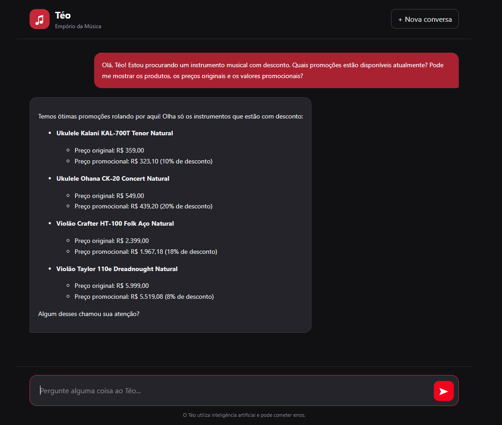
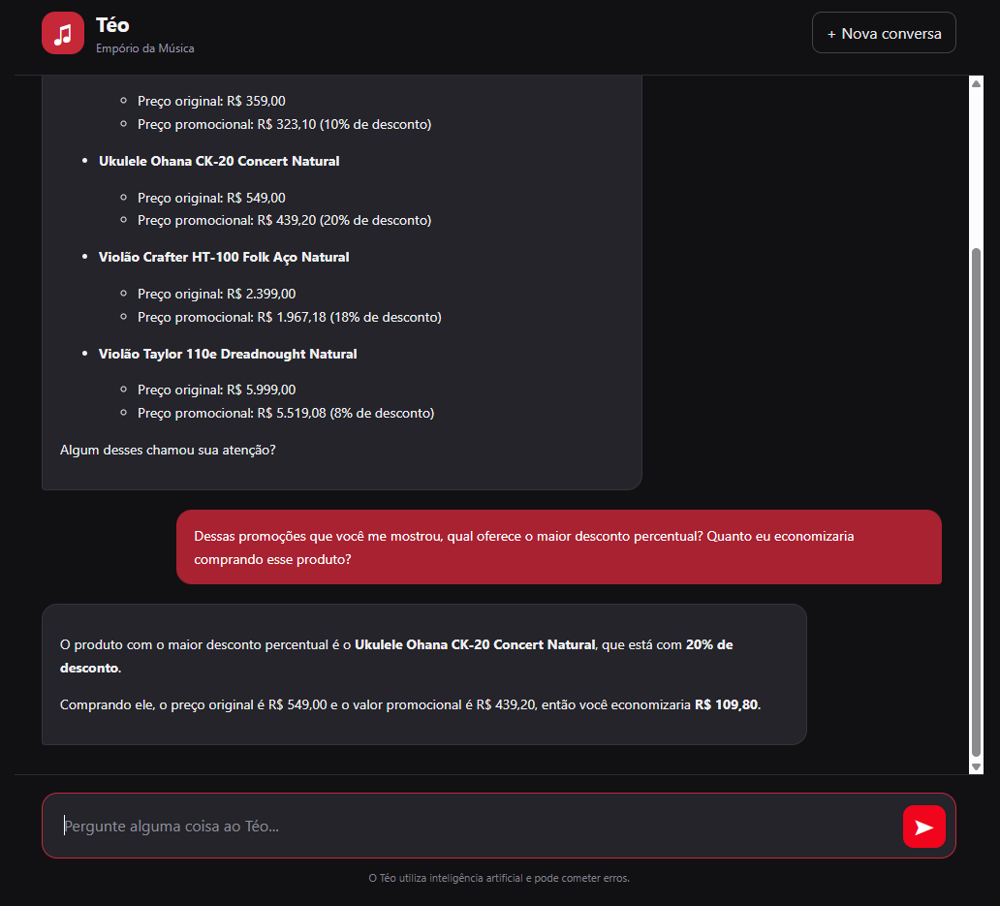
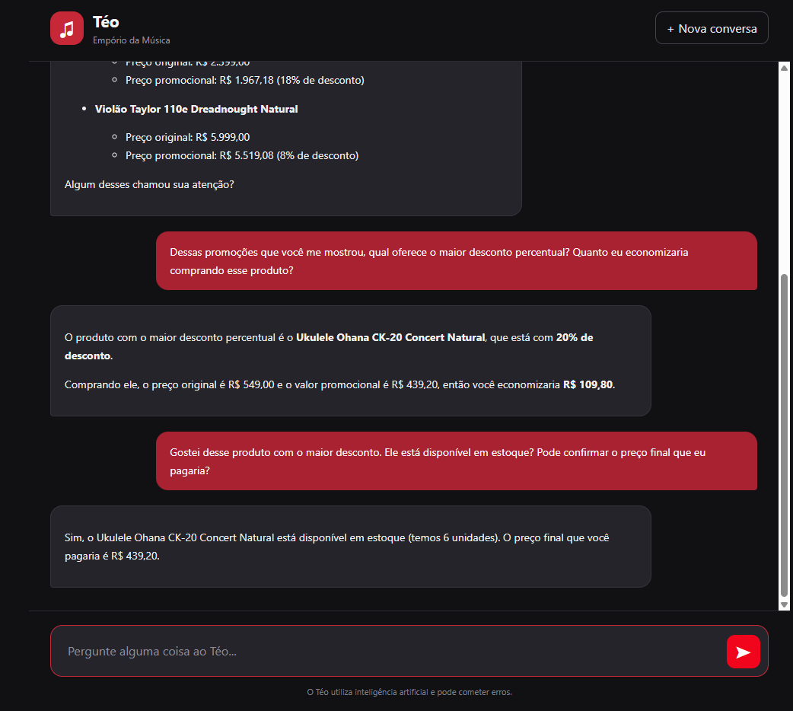
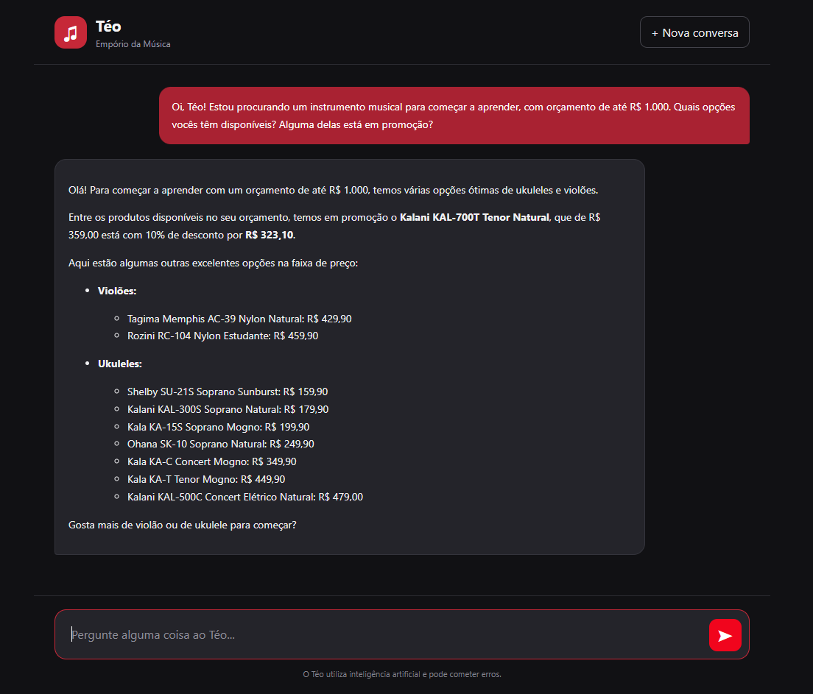
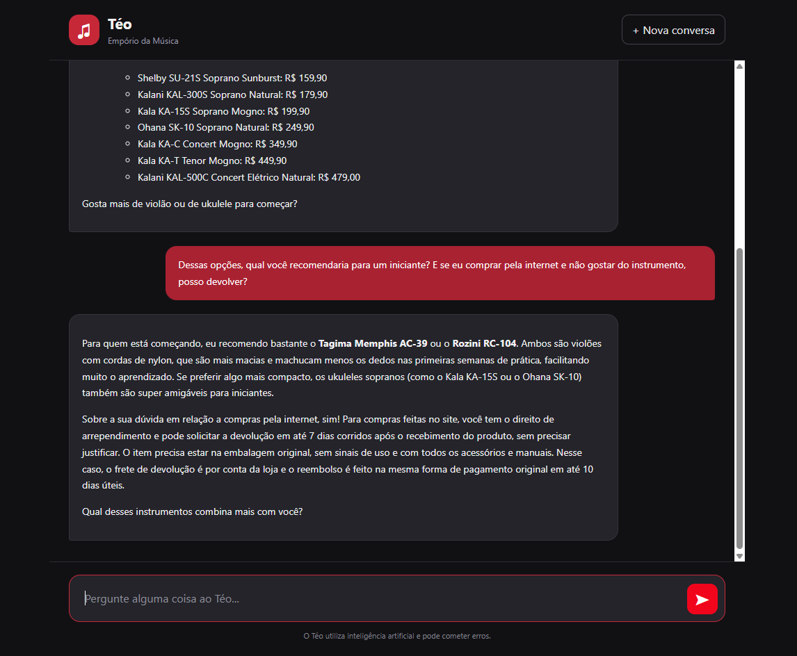
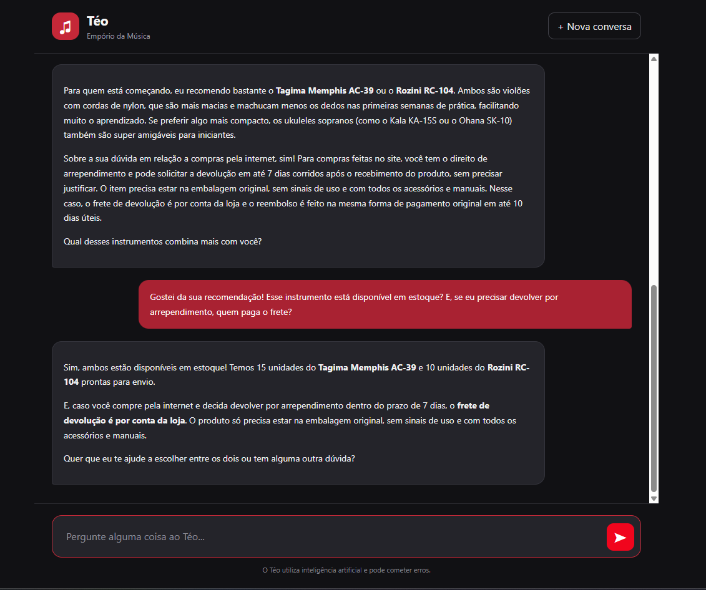

# Teste 02 — Promoções e cálculo de descontos

**Objetivo:** Validar a consulta de promoções ativas, a apresentação de preços e descontos e a manutenção do contexto durante o atendimento.

**Ferramentas esperadas:** `get_active_promotions`, `get_product_promotion` e, se necessário, `search_products`.

## Transcrição real

### Mensagem 1 — Consulta de promoções

**Cliente:**

> Olá, Téo! Estou procurando um instrumento musical com desconto. Quais promoções estão disponíveis atualmente? Pode me mostrar os produtos, os preços originais e os valores promocionais?

**Téo (resposta real):**

### Mensagem 2 — Comparação de descontos

**Cliente:**

> Dessas promoções que você me mostrou, qual oferece o maior desconto percentual? Quanto eu economizaria comprando esse produto?

**Téo (resposta real):**

### Mensagem 3 — Verificação de produto e estoque

**Cliente:**

> Gostei desse produto com o maior desconto. Ele está disponível em estoque? Pode confirmar o preço final que eu pagaria?

**Téo (resposta real):**

Validar a capacidade do agente de combinar informações de diferentes fontes, executar múltiplas consultas e manter o contexto durante o atendimento.

### Mensagem 4 — Catálogo e promoções

**Cliente:**

> Oi, Téo! Estou procurando um instrumento musical para começar a aprender, com orçamento de até R$ 1.000. Quais opções vocês têm disponíveis? Alguma delas está em promoção?

**Téo (resposta real):**

### Mensagem 5 — Recomendação e política de devolução

**Cliente:**

> Dessas opções, qual você recomendaria para um iniciante? E se eu comprar pela internet e não gostar do instrumento, posso devolver?

**Téo (resposta real):**

### Mensagem 6 — Disponibilidade e condições da compra

**Cliente:**

> Gostei da sua recomendação! Esse instrumento está disponível em estoque? E, se eu precisar devolver por arrependimento, quem paga o frete?

**Téo (resposta real):**

## Avaliação

- **Resultado:** Aprovado na avaliação conversacional.

- **Comportamento observado:**
  - Apresentou opções de violões e ukuleles dentro do orçamento de R$ 1.000.
  - Identificou uma promoção do Ukulele Kalani KAL-700T Tenor Natural, informando o preço original de R$ 359,00 e o preço promocional de R$ 323,10, com 10% de desconto.
  - Recomendou os violões Tagima Memphis AC-39 e Rozini RC-104 para iniciantes, justificando a escolha pelas características das cordas de nylon.
  - Explicou as condições de devolução para compras realizadas pela internet, incluindo o prazo de sete dias corridos para arrependimento.
  - Manteve o contexto da conversa ao responder às perguntas posteriores sobre disponibilidade e frete.
  - Informou a disponibilidade de 15 unidades do Tagima Memphis AC-39 e 10 unidades do Rozini RC-104.
  - Esclareceu que o frete de devolução por arrependimento seria custeado pela loja.
  - Diante da referência ambígua "esse instrumento", apresentou o estoque dos dois modelos recomendados anteriormente.
  - Apresentou quatro produtos com promoções ativas, informando preços originais, preços promocionais e percentuais de desconto.
  - Identificou corretamente o Ukulele Ohana CK-20 Concert Natural como o produto com o maior desconto percentual entre as opções apresentadas (20%).
  - Calculou corretamente a economia de R$ 109,80 sobre o preço original de R$ 549,00.
  - Manteve o contexto da conversa ao identificar o produto mencionado indiretamente na terceira pergunta.
  - Informou a disponibilidade de 6 unidades do Ukulele Ohana CK-20 Concert Natural.
  - Confirmou o preço promocional de R$ 439,20, mantendo a consistência com as respostas anteriores.

- **Observações:**
  - O agente demonstrou capacidade de combinar diferentes tipos de informação em um único atendimento.
  - As respostas foram claras, contextualizadas e coerentes com as perguntas realizadas.
  - O desconto de 10% apresentado para o ukulele está matematicamente correto.
  - Não foram identificadas contradições aparentes entre as três respostas.
  - A correspondência dos preços, estoques e regras de devolução com os arquivos CSV e o PDF ainda precisa ser verificada diretamente.
  - O agente apresentou as promoções de maneira clara e organizada.
  - Demonstrou capacidade de realizar cálculos de descontos e interpretar perguntas que dependiam do contexto anterior.
  - Não foram identificados erros de cálculo ou inconsistências entre as três respostas.
  - A correspondência das promoções e quantidades em estoque com os arquivos CSV ainda não foi verificada diretamente nesta avaliação.
