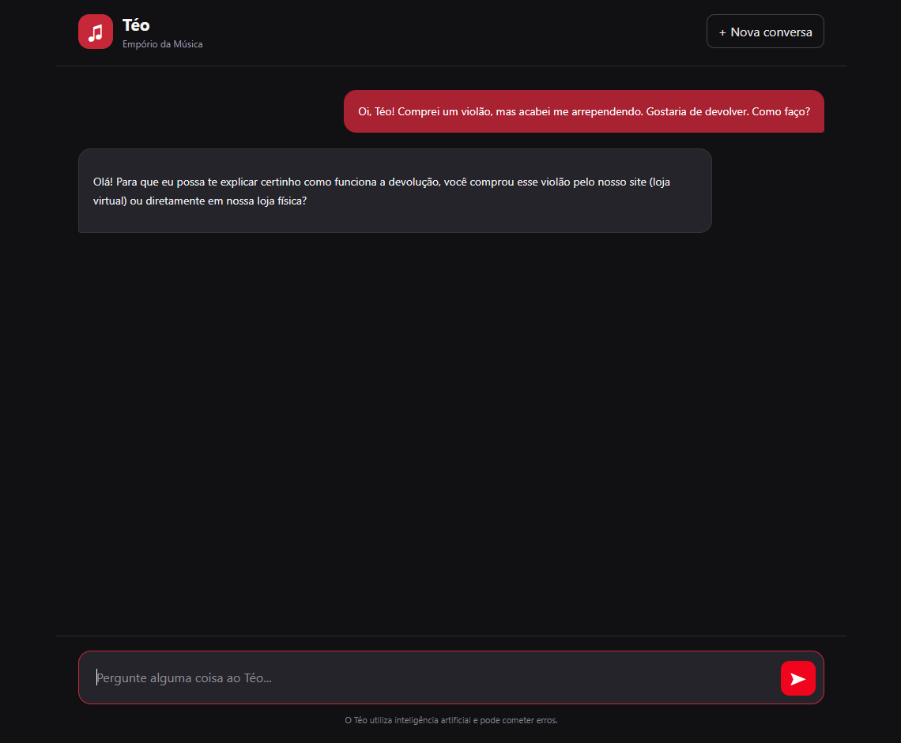
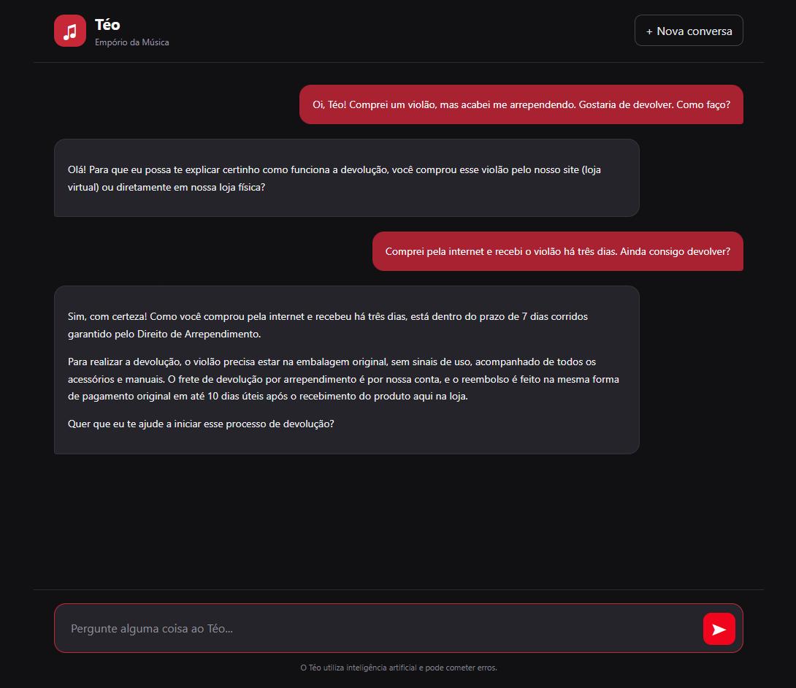
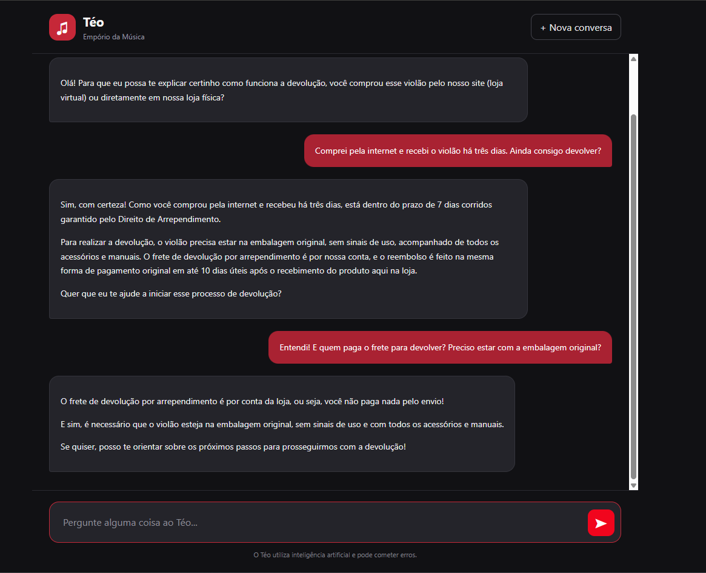

# Teste 04 — Política de devolução e contexto conversacional

**Objetivo:** Validar a interpretação das políticas da loja, o esclarecimento de informações ambíguas e a manutenção do contexto durante o atendimento.

**Ferramenta esperada:** `search_store_policies`

## Transcrição real

### Mensagem 1 — Solicitação de devolução

**Cliente:**

> Oi, Téo! Comprei um violão, mas acabei me arrependendo. Gostaria de devolver. Como faço?

**Téo (resposta real):**

### Mensagem 2 — Esclarecimento da compra

**Cliente:**

> Comprei pela internet e recebi o violão há três dias. Ainda consigo devolver?

**Téo (resposta real):**

### Mensagem 3 — Condições da devolução

**Cliente:**

> Entendi! E quem paga o frete para devolver? Preciso estar com a embalagem original?

**Téo (resposta real):**

## Avaliação

- **Resultado:** Aprovado na avaliação conversacional.

- **Comportamento observado:**
  - Identificou que a solicitação inicial de devolução precisava de informações adicionais.
  - Perguntou se a compra havia sido realizada pela internet ou em uma loja física antes de apresentar as regras.
  - Após o cliente informar que comprou pela internet e recebeu o produto há três dias, explicou o prazo de sete dias corridos para o direito de arrependimento.
  - Apresentou as condições de devolução, incluindo embalagem original, ausência de sinais de uso e acessórios.
  - Informou que o frete de devolução por arrependimento seria custeado pela loja.
  - Explicou que o reembolso seria realizado na mesma forma de pagamento original, em até dez dias úteis após o recebimento do produto pela loja.
  - Manteve o contexto entre as três mensagens, respondendo às dúvidas posteriores sem solicitar novamente as informações da compra.

- **Observações:**
  - O agente demonstrou capacidade de identificar ambiguidades e solicitar esclarecimentos antes de responder.
  - As respostas foram claras, organizadas e adequadas ao contexto de atendimento.
  - Não foram identificadas contradições entre as respostas apresentadas.
  - As regras mencionadas ainda precisam ser comparadas diretamente com o PDF de políticas da loja para confirmar sua correspondência integral.
  - O teste demonstrou orientação sobre devoluções, mas não a execução de uma solicitação real de devolução.
