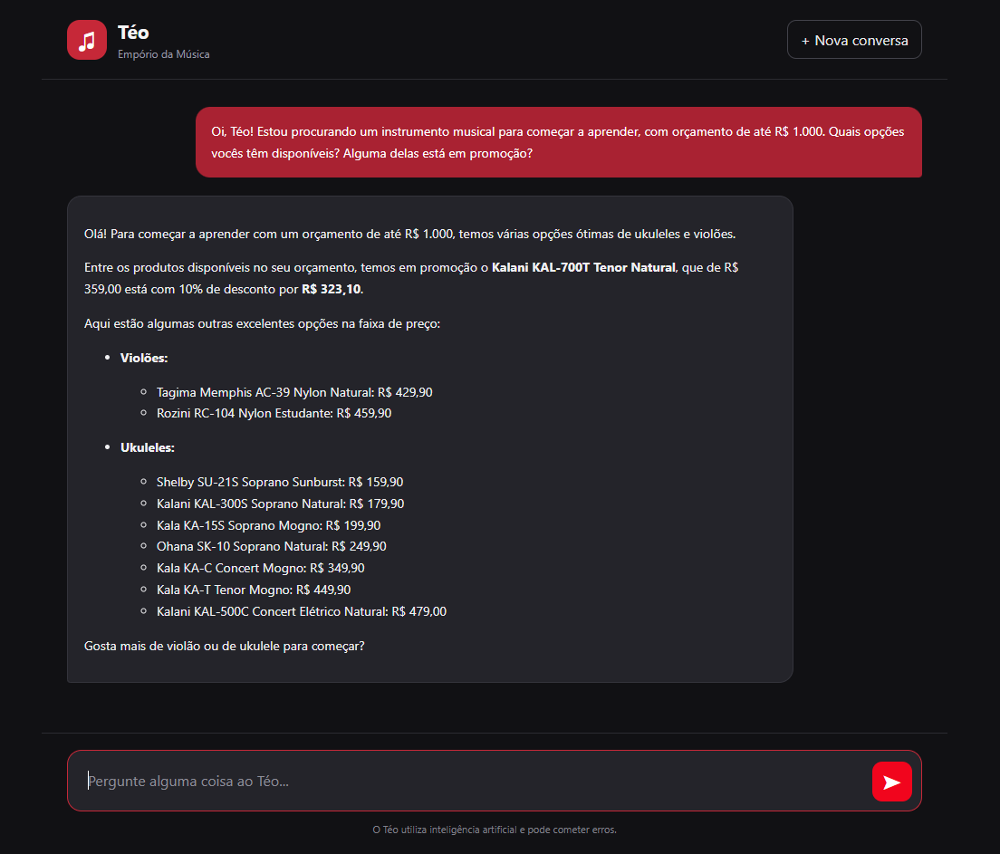
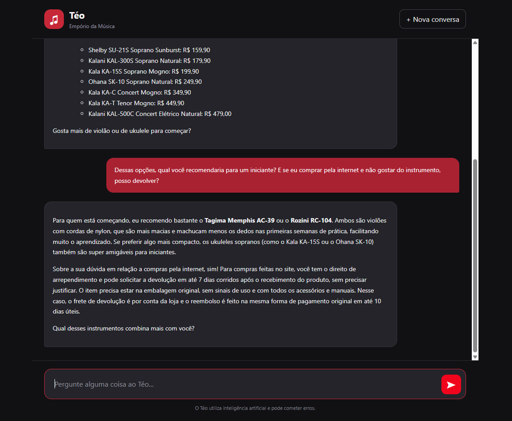
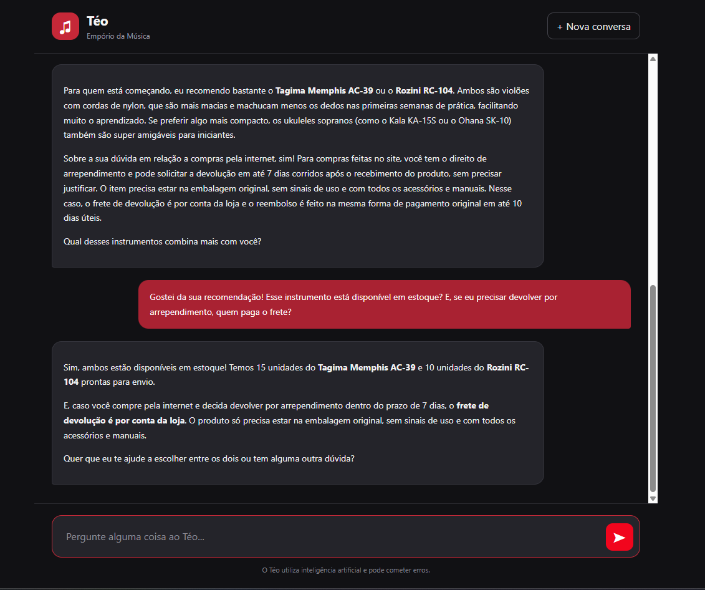

# Teste 05 — Consulta combinada e orquestração de ferramentas

**Objetivo:** Validar a capacidade do agente de combinar informações de diferentes fontes, executar múltiplas consultas e manter o contexto durante o atendimento.

**Ferramentas esperadas:** `search_products`, `get_active_promotions`, `get_product_promotion` e `search_store_policies`, conforme a necessidade.

## Transcrição real

### Mensagem 1 — Catálogo e promoções

**Cliente:**

> Oi, Téo! Estou procurando um instrumento musical para começar a aprender, com orçamento de até R$ 1.000. Quais opções vocês têm disponíveis? Alguma delas está em promoção?

**Téo (resposta real):**

### Mensagem 2 — Recomendação e política de devolução

**Cliente:**

> Dessas opções, qual você recomendaria para um iniciante? E se eu comprar pela internet e não gostar do instrumento, posso devolver?

**Téo (resposta real):**

### Mensagem 3 — Disponibilidade e condições da compra

**Cliente:**

> Gostei da sua recomendação! Esse instrumento está disponível em estoque? E, se eu precisar devolver por arrependimento, quem paga o frete?

**Téo (resposta real):**

## Avaliação

- **Resultado:** Aprovado na avaliação conversacional.

- **Comportamento observado:**
  - Apresentou opções de violões e ukuleles dentro do orçamento de R$ 1.000.
  - Identificou uma promoção do Ukulele Kalani KAL-700T Tenor Natural, informando o preço original de R$ 359,00 e o preço promocional de R$ 323,10, com 10% de desconto.
  - Recomendou os violões Tagima Memphis AC-39 e Rozini RC-104 para iniciantes, justificando a escolha pelas características das cordas de nylon.
  - Explicou as condições de devolução para compras realizadas pela internet, incluindo o prazo de sete dias corridos para arrependimento.
  - Manteve o contexto da conversa ao responder às perguntas posteriores sobre disponibilidade e frete.
  - Informou a disponibilidade de 15 unidades do Tagima Memphis AC-39 e 10 unidades do Rozini RC-104.
  - Esclareceu que o frete de devolução por arrependimento seria custeado pela loja.
  - Diante da referência ambígua "esse instrumento", apresentou o estoque dos dois modelos recomendados anteriormente.

- **Observações:**
  - O agente demonstrou capacidade de combinar diferentes tipos de informação em um único atendimento.
  - As respostas foram claras, contextualizadas e coerentes com as perguntas realizadas.
  - O desconto de 10% apresentado para o ukulele está matematicamente correto.
  - Não foram identificadas contradições aparentes entre as três respostas.
  - A correspondência dos preços, estoques e regras de devolução com os arquivos CSV e o PDF ainda precisa ser verificada diretamente.
 